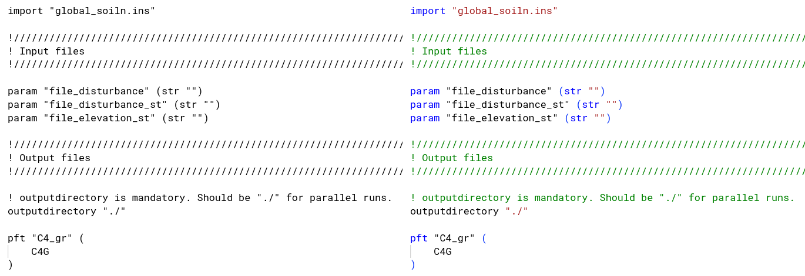
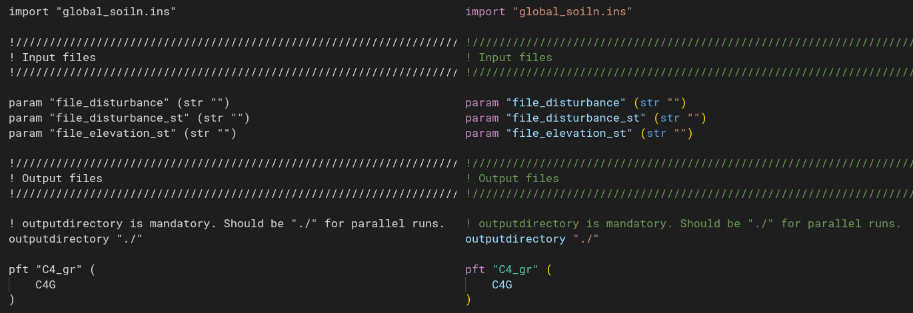

# LPJ-GUESS Instruction File (.ins) Support for Visual Studio Code

A minimal VS Code language extension for LPJ-GUESS instruction files (`*.ins`).

This extension provides syntax highlighting for LPJ-GUESS instruction files,
which are used to configure the LPJ-GUESS vegetation model.

## Install Locally (from this repo)

```bash
npm ci
npx @vscode/vsce package

# This will create a .vsix file, which you can install in VS Code:
code --install-extension lpj-ins-X.Y.Z.vsix # Adjust filename as needed
```

## Screenshots



